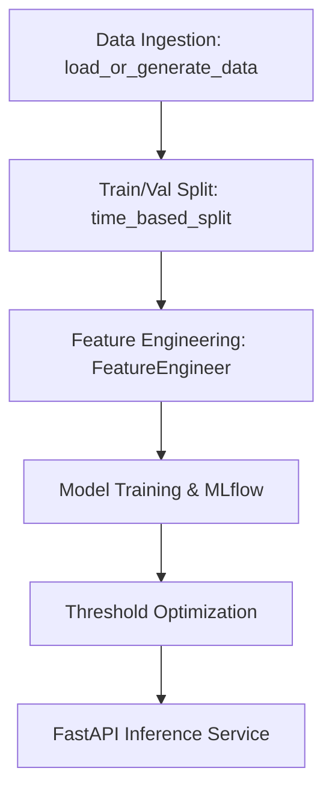

# FraudLens

Production-ready imbalanced financial fraud detection platform.

## Architecture

## Engineering Trade-offs

1. **Metrics:**
   - On highly imbalanced data (e.g. <1% fraud), ROC-AUC can be misleading because the vast number of True Negatives drives the False Positive Rate down, even if precision is poor.
   - We prioritize **PR-AUC (Average Precision)** because it only focuses on the positive class (fraud), making it a much more sensitive metric for severe imbalance.

2. **Class Imbalance Handling:**
   - We use algorithmic weighting (`class_weight='balanced'` in Scikit-Learn or `scale_pos_weight` in XGBoost) to penalize the model more for missing fraud cases during training.
   - We supplement this with explicit **threshold optimization** post-training. The naive 0.5 decision boundary is arbitrary. We sweep thresholds to maximize the F2-score (weighting recall over precision) while enforcing a hard 5% maximum ceiling on False Positive Rate to minimize operational overhead.

3. **Data Leakage Prevention:**
   - Time-based train/validation splitting is strictly enforced. Random splits are forbidden because future behavioral patterns would leak into the training set.
   - The `FeatureEngineer` component `fit` method only operates on the training set to learn target-encoded variables like merchant risk scores and user amount means. These learned parameters are then fixed and blindly applied to the validation set and live inference requests.
